<h1 align="center">Ivan Mytrofanov</h1>

  <b>Java Backend Developer</b> · Prague 
  Building <a href="https://wayoni.com"><b>Wayoni</b></a>, a travel search engine running in production

  
  
  
  

---

### About me

- 🎓 CS student at **SPŠE Ječná**, Prague
- 🚀 Built and run **Wayoni** solo: Spring Boot API & security, React frontend, CI/CD and server ops
- 📱 Currently learning **Swift / SwiftUI**
- 🤝 Open to a **part-time junior backend role**
- 🏔️ Off the keyboard: mountaineering, gym, guitar

---

### 🌍 Featured project: [Wayoni](https://wayoni.com)

> Travel destination search engine that ranks cities, regions and countries by what *you* are interested in.

- **Java 21 / Spring Boot 4** backend: ~28k LOC, 850+ commits, weighted multi-level scoring (city → region → country) with tiered ranking
- **Auth end-to-end:** JWT in HttpOnly cookies, Google OAuth2, email verification, password reset, recovery codes, login throttling, admin audit log
- **External data:** Travelpayouts flight prices + FlixBus GTFS timetables via Python ETL, hot paths cached with Caffeine
- **PostgreSQL + Flyway**, ~80 test classes running against a real PostgreSQL instance in CI
- **CI/CD:** GitHub Actions → Docker → GHCR → Linux VPS behind Nginx + Let's Encrypt, nightly encrypted backups to Backblaze B2
- **Frontend:** React 19 + TypeScript (Vite), SEO prerendering with Puppeteer

Public repo: <a href="https://github.com/vanish-gold16/wayoni_public">wayoni_public</a>

### Other projects

| Project | What it is | Stack |
|---|---|---|
| [mMusic](https://github.com/vanish-gold16/mMusic) | iOS app, my Swift/SwiftUI playground <!-- TODO: one-line description --> | Swift, SwiftUI |
| [ISC](https://github.com/vanish-gold16/ISC) | International Students Community website | HTML, CSS |
| [NullState](https://github.com/vanish-gold16/NullState) | Text game in a cyberpunk setting (school project) | Java |

---

### 🧩 Tech stack

**Backend** 

**Data** 

**DevOps** 

**Frontend & Mobile** 

---

### 📈 GitHub stats

  
  

---

### 🗣️ Languages

Ukrainian & Russian (native) · English & Czech (upper-intermediate) · Greek (intermediate) · Japanese (basic)
